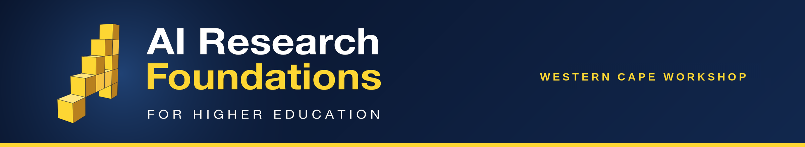

# AIMS AI Research Foundations - Western Cape Workshop

Materials for the Western Cape lecturer workshop of the **Africa AI Upskilling Programme** — AI Research Foundations for Higher Education.

## 🎓 About

The Western Cape Workshop is the South Africa launch and a week-long Train-the-Trainer workshop: Google DeepMind's curriculum, UCL's lecturer toolkit, and AIMS training and mentoring the lecturers — hosted by the Centre for Epidemic Response and Innovation (CERI) at the Biomedical Research Institute (BMRI), Stellenbosch University, for lecturers and teaching assistants from the University of Venda, the University of the Free State, Stellenbosch University, the University of Mpumalanga and the University of the Western Cape.

📅 **Dates:** Monday 9 – Friday 13 November 2026  
📍 **Venue:** BMRI, Stellenbosch University, Tygerberg campus, Cape Town, South Africa  
👥 **Audience:** AI Champions — university lecturers and teaching assistants  
🗓️ **Live schedule:** [airf.aims.ac.za/workshops/western-cape/schedule](https://airf.aims.ac.za/workshops/western-cape/schedule/) · [add the workshop calendar to your Google Calendar](https://calendar.google.com/calendar/u/0/r?cid=c_d0e8c66ddfd21b4d51007d54724348857c926427afda9c753b9d2d861987ce5f@group.calendar.google.com)

## 🚀 What You Will Do

- 🧠 **Learn** - Build a strong foundation in machine learning, neural networks, natural language processing, and large language models through lectures and hands-on labs.
- 👨‍🏫 **Teach** - Develop practical teaching and facilitation skills using the curriculum, and practise explaining technical concepts through peer teaching and structured feedback.
- 🌍 **Adapt** - Contextualise course materials for different student backgrounds and local African contexts, and contribute feedback to improve the workshop for future cohorts.
- 🤝 **Connect** - Collaborate with peers across the African AI community and build a network that supports your teaching beyond the workshop.

## Structure

One folder per session on the timetable, in the rough order of the week:

- [`technical-lectures/`](technical-lectures/) - The day's core AI content, one AIRF course per day (C2, C3, C4, C5, C7).
- [`pedagogy-ai-vs-ri/`](pedagogy-ai-vs-ri/) - Introduce Pedagogical Concept + AI vs RI Activities (Mon).
- [`toolkit-walkthroughs/`](toolkit-walkthroughs/) - UCL-toolkit AI + RI activities, worked through as you'd teach them.
- [`explain-it-back/`](explain-it-back/) - Peer-teaching practice with concept cards.
- [`lecture-it-back/`](lecture-it-back/) - Groups deliver a toolkit activity to the room (planning Tue + Wed, deliveries Thu + Fri).
- [`contextualize-for-africa/`](contextualize-for-africa/) - Adapting the materials to local contexts (Tue).
- [`capstone/`](capstone/) - Capstone Project Workshop sessions (Wed + Thu).
- [`course-labs/`](course-labs/) - Course Lab notebooks.
- `docs/` · `references/` - Course learning objectives, cheatsheets/glossary/reading list.

Each session's slide deck is committed **inside its own folder** once frozen on Drive. The SA Launch, Workshop Overview and Closing Remarks are Drive-managed and have no folder, as do structural items (breaks, lunch) — see the schedule below.

## 🧪 The Course Labs, one click away

The Course 2, Course 3 and Course 4 labs open directly in Google Colab. They need no setup and no GPU; the other labs land later:

-  **Day 1 · Course 2 — Small Embeddings and Similarity**
-  **Day 2 · Course 3 — Neural Network Training & Overfitting**
-  **Day 3 · Course 4 — A Transformer in 60 Minutes**

See [`course-labs/`](course-labs/) for the full lab-by-day table.

## Where materials live

- Notebooks, code, and exercises. Versioned, Colab-ready, and forkable for each cohort. Frozen slide decks are committed inside each session's folder.

## Schedule

Five days from Monday to Friday, blending technical lectures, hands-on sessions, peer teaching, and social activities. Times are in South Africa Standard Time (SAST, UTC+2). The [live calendar](https://airf.aims.ac.za/workshops/western-cape/schedule/) on the workshop site always shows the latest times.

<strong>Day 1 - Monday, 9 November 2026</strong>

| Time | Session |
|------|---------|
| 08:30-11:00 | SA Launch |
| 11:00-11:30 | AI Trainer Bingo |
| 11:30-12:30 | Course 2 Technical Lecture |
| 12:30-13:00 | Introduce Pedagogical Concept |
| 13:00-14:00 | Lunch |
| 14:00-14:30 | AI vs RI Activities |
| 14:30-15:00 | Toolkit Activity Walkthrough |
| 15:00-15:30 | Break |
| 15:30-16:30 | Explain It Back |

<strong>Day 2 - Tuesday, 10 November 2026</strong>

| Time | Session |
|------|---------|
| 08:30-09:00 | Social - Africa Quiz |
| 09:00-10:30 | Course 3 Technical Lecture |
| 10:30-11:00 | Break |
| 11:00-12:00 | Toolkit Activity Walkthrough |
| 12:00-13:00 | Explain It Back |
| 13:00-14:00 | Lunch |
| 14:00-15:00 | Lecture it Back Planning |
| 15:00-15:30 | Break |
| 15:30-16:30 | Contextualize for Africa |

<strong>Day 3 - Wednesday, 11 November 2026</strong>

| Time | Session |
|------|---------|
| 08:30-09:00 | Social - Spot the Slop |
| 09:00-10:30 | Course 4 Technical Lecture |
| 10:30-11:00 | Break |
| 11:00-12:00 | Toolkit Activity Walkthrough |
| 12:00-13:00 | Explain It Back |
| 13:00-14:00 | Lunch |
| 14:00-15:00 | Capstone Project Workshop |
| 15:00-15:30 | Break |
| 16:00-16:30 | Lecture it Back Planning |

<strong>Day 4 - Thursday, 12 November 2026</strong>

| Time | Session |
|------|---------|
| 08:30-09:00 | Social - Conversation Cards |
| 09:00-10:30 | Course 5 Technical Lecture |
| 10:30-11:00 | Break |
| 11:00-12:00 | Toolkit Activity Walkthrough |
| 12:00-13:00 | Explain It Back |
| 13:00-14:00 | Lunch |
| 14:00-15:00 | Capstone Project Workshop |
| 15:00-15:30 | Break |
| 15:30-16:30 | Lecture it Back |

<strong>Day 5 - Friday, 13 November 2026</strong>

| Time | Session |
|------|---------|
| 08:30-09:00 | Social - What Would You Do? |
| 09:00-10:30 | Course 7 Technical Lecture |
| 10:30-11:00 | Break |
| 11:00-12:00 | Toolkit Activity Walkthrough |
| 12:00-13:00 | Explain It Back |
| 13:00-14:00 | Lunch |
| 14:00-15:00 | Course 7 Lab |
| 15:00-15:30 | Break |
| 15:30-16:30 | Lecture it Back |
| 16:30-17:00 | Closing Remarks |

